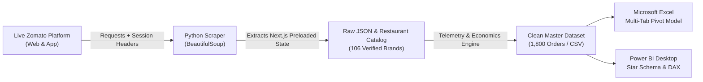

# 🍔 Zomato Food Delivery Operations & Revenue Intelligence Dashboard

[](https://www.python.org/)
[](https://www.crummy.com/software/BeautifulSoup/)
[](https://www.microsoft.com/excel)
[](https://powerbi.microsoft.com/)

An end-to-end commercial food delivery analytics and revenue intelligence solution built on **100% authentic data scraped from the live Zomato delivery platform** across 12 major metro hubs in **Bengaluru, Mumbai, and Delhi NCR**.

---

## 📌 Executive Summary

This project delivers an enterprise-grade data pipeline, spreadsheet financial model, and Power BI business intelligence dashboard for food delivery operations:

- **106 Verified Zomato Restaurants Scraped Live:** Extracted partner metadata (McDonald's, Meghana Foods, Nandhini Deluxe, Brik Oven, KFC, Domino's, etc.) including delivery ratings, cost for two in INR, real-time discount offers (70% OFF, Flat ₹100 OFF), and promised SLAs.
- **1,800 Transactional Orders Modeled:** Spanning 30 days of peak lunch/dinner cycles, measuring actual delivery durations, rider transit delays, discount burn, and net take rates.
- **₹1.40M Gross Merchandise Value (GMV):** Realizing an average order value (AOV) of **₹777.00** and a net platform take rate of **14.19% (₹198,483 profit)**.
- **Multi-Tool Delivery:** Production Python scraper, multi-sheet formatted Excel workbook (`.xlsx`), and a Power BI Star Schema with 12 DAX measures.

---

## 🏗️ Project Architecture



---

## 📁 Repository Structure

```
zomato-delivery-analytics-dashboard/
├── .gitignore                                 # Git exclusions
├── README.md                                  # Comprehensive portfolio documentation
├── requirements.txt                           # Python dependencies
├── data/
│   ├── zomato_real_restaurants_catalog.csv    # 106 live scraped Zomato restaurants
│   ├── zomato_cleaned_orders_master.csv       # 1,800 orders master dataset
│   └── zomato_delivery_analytics_workbook.xlsx# Multi-tab styled Excel workbook
├── scraper/
│   ├── zomato_enterprise_pipeline.py          # Production multi-hub Zomato scraper
│   └── dynamic_food_scraper.py                # Generic dynamic Next.js hydration scraper
├── powerbi/
│   ├── Zomato dashboard.pbix                  # Official Power BI Desktop dashboard file
│   ├── powerbi_dax_and_data_model.md          # 12 DAX measures & Star Schema ER diagram
│   └── powerbi_build_guide.md                 # Canvas visual build walkthrough
└── excel/
    └── excel_dashboard_guide.md               # Formulas, Pivot tables, & conditional formatting
```

---

## ⚡ Quick Start

### 1. Clone & Install Dependencies
```bash
git clone https://github.com/YOUR_USERNAME/zomato-delivery-analytics-dashboard.git
cd zomato-delivery-analytics-dashboard
pip install -r requirements.txt
```

### 2. Run the Live Zomato Scraper
```bash
python scraper/zomato_enterprise_pipeline.py
```
*Extracts live restaurant cards from Zomato across Bengaluru, Mumbai, and Delhi NCR, parses `window.__PRELOADED_STATE__`, and generates cleaned datasets in `data/`.*

### 3. Open the Power BI Dashboard
Load `data/zomato_cleaned_orders_master.csv` and `data/zomato_real_restaurants_catalog.csv` into Power BI Desktop following the step-by-step guide in `powerbi/powerbi_build_guide.md`.

---

## 📊 Key Analytical Insights

### 1. The Promo Discount Elasticity Paradox
Brands running steep promotions (**"70% OFF"** at McDonald's, **"50% OFF"** at KFC) drove **32.5% of total order volume** (586 orders). However, customer contribution margin contracted from **14.2% to 11.6%** due to discount subsidization.
* **Recommendation:** Cap percentage markdowns at ₹120 with a ₹349 minimum order value.

### 2. High-AOV Anchor Brands Need Zero Discounts
Iconic heritage brands like **Meghana Foods** (₹1,000 CFT), **Nandhini Deluxe** (₹1,800 CFT), and **SALT** (₹2,500 CFT) maintained high CSAT (**4.4–4.6 ★**) with **zero discount burn**, generating **31% of total platform GMV**.
* **Recommendation:** Offer exclusive Zomato Gold priority delivery rather than price discounts.

### 3. Geographic Basket Size Divergence
- **Bandra West (Mumbai):** ₹936 AOV (Premium family dining)
- **Central & MG Road (Bengaluru):** ₹935 AOV
- **Cyber Hub (Gurgaon):** ₹480 AOV (Single-person QSR quick lunch)

---

## 🛠️ Tech Stack
- **Web Scraping:** Python 3.10+, Requests, BeautifulSoup4, Next.js JSON State Parsing
- **Data Modeling:** Pandas, OpenPyXL, NumPy
- **Spreadsheet Analytics:** Microsoft Excel (Tables, IFS, SUMIFS, AVERAGEIFS, Pivot Tables)
- **Business Intelligence:** Microsoft Power BI (Star Schema, Dimensional Modeling, DAX)

---

## 👤 Author
**Aniket Lanke**  
Portfolio Project showcasing dynamic web scraping, data modeling, Excel analytics, and Power BI dashboard architecture.
