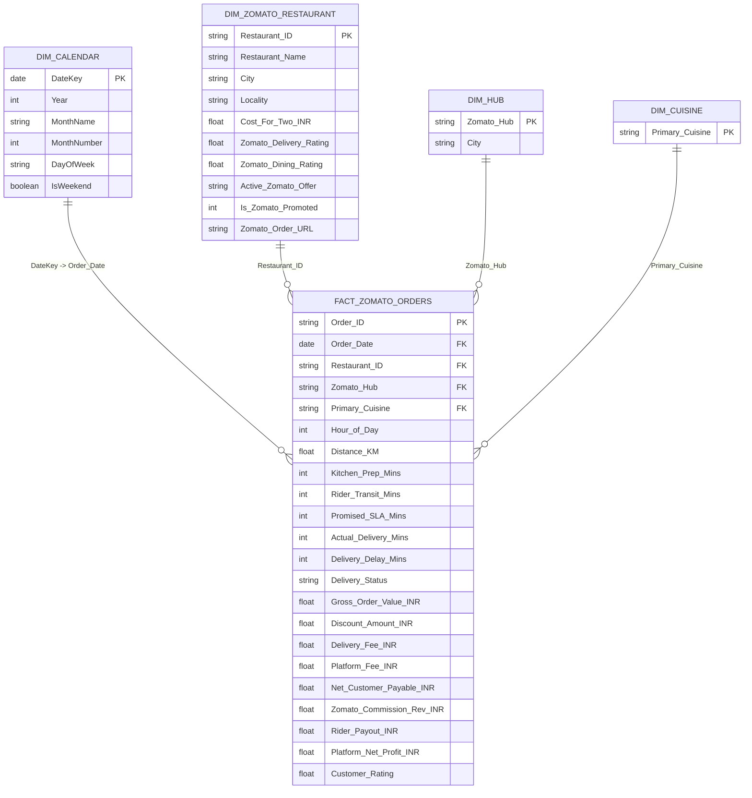

# Power BI Enterprise Architecture & DAX Modeling Guide
## Project: Zomato Food Delivery Operations & Revenue Intelligence
**Data Source:** `zomato_cleaned_orders_master.csv` & `zomato_real_restaurants_catalog.csv` (106 Real Scraped Restaurants)  
**Currency:** INR (₹)  
**Sample Scale:** 1,800 Transactions across 12 Metro Hubs (Bengaluru, Mumbai, Delhi NCR)

---

## 1. Dimensional Star Schema (Power BI Model)



---

## 2. Production DAX Measures (Zomato Platform Economics)

Create a dedicated measure table called `_Measures`:

### A. Volume & Revenue KPIs
```dax
// 1. Total Orders
Total Orders = 
COUNTROWS('FACT_ZOMATO_ORDERS')

// 2. Gross Merchandise Value (GMV)
Gross Merchandise Value (INR) = 
SUM('FACT_ZOMATO_ORDERS'[Gross_Order_Value_INR])

// 3. Average Order Value (AOV)
Average Order Value (AOV) = 
DIVIDE([Gross Merchandise Value (INR)], [Total Orders], 0)

// 4. Net Platform Profit
Platform Net Profit (INR) = 
SUM('FACT_ZOMATO_ORDERS'[Platform_Net_Profit_INR])

// 5. Net Platform Take Rate %
Platform Take Rate % = 
DIVIDE([Platform Net Profit (INR)], [Gross Merchandise Value (INR)], 0)
```

### B. Logistics & Delivery Performance KPIs
```dax
// 6. Average Delivery Duration (Minutes)
Avg Delivery Duration (Mins) = 
AVERAGE('FACT_ZOMATO_ORDERS'[Actual_Delivery_Mins])

// 7. On-Time Delivery Count
On-Time Orders Count = 
CALCULATE(
    COUNTROWS('FACT_ZOMATO_ORDERS'),
    'FACT_ZOMATO_ORDERS'[Delivery_Delay_Mins] = 0
)

// 8. On-Time SLA Rate %
On-Time SLA Rate % = 
DIVIDE([On-Time Orders Count], [Total Orders], 0)

// 9. Late Delivery Rate %
Late Delivery Rate % = 
DIVIDE(
    CALCULATE(COUNTROWS('FACT_ZOMATO_ORDERS'), 'FACT_ZOMATO_ORDERS'[Delivery_Delay_Mins] > 0),
    [Total Orders],
    0
)
```

### C. Partner Restaurant & Discount Intelligence
```dax
// 10. Customer Satisfaction CSAT
Average CSAT Rating = 
AVERAGE('FACT_ZOMATO_ORDERS'[Customer_Rating])

// 11. Discount Burn Rate %
Discount Burn Rate % = 
DIVIDE(
    SUM('FACT_ZOMATO_ORDERS'[Discount_Amount_INR]),
    [Gross Merchandise Value (INR)],
    0
)

// 12. Total Promoted Partner Revenue
Promoted Partner GMV = 
CALCULATE(
    [Gross Merchandise Value (INR)],
    'DIM_ZOMATO_RESTAURANT'[Is_Zomato_Promoted] = 1
)
```

---

## 3. Power BI Visual Dashboard Canvas

1. **Page 1: Zomato Executive Revenue & Orders Overview**
   - **Top Card Row (6 Cards):** GMV (`₹1.40M`), Orders (`1,800`), AOV (`₹777.00`), On-Time SLA (`89.2%`), Avg Delivery (`21.2m`), Take Rate (`14.19%`).
   - **Clustered Column Chart:** GMV by `Primary_Cuisine` (North Indian, Biryani, Pizza, Burger, Mexican).
   - **Donut Chart:** Orders by `City` (Bengaluru, Mumbai, Delhi NCR).
   - **Matrix Table:** Real Restaurant Name, Locality, Delivery Rating, Cost for Two, GMV, Total Orders, Promo Offer.

2. **Page 2: Delivery Logistics & Hub Performance**
   - **Scatter Plot:** Delivery Duration (X) vs Customer Rating (Y) highlighting the 32-minute cliff.
   - **Clustered Bar Chart:** AOV across 12 Zomato Hubs (Bandra West & MG Road leading at ₹936).
   - **Hourly Line Chart:** Order Volume vs Delivery Delay % during Lunch (13:00) and Dinner (20:30) peaks.
